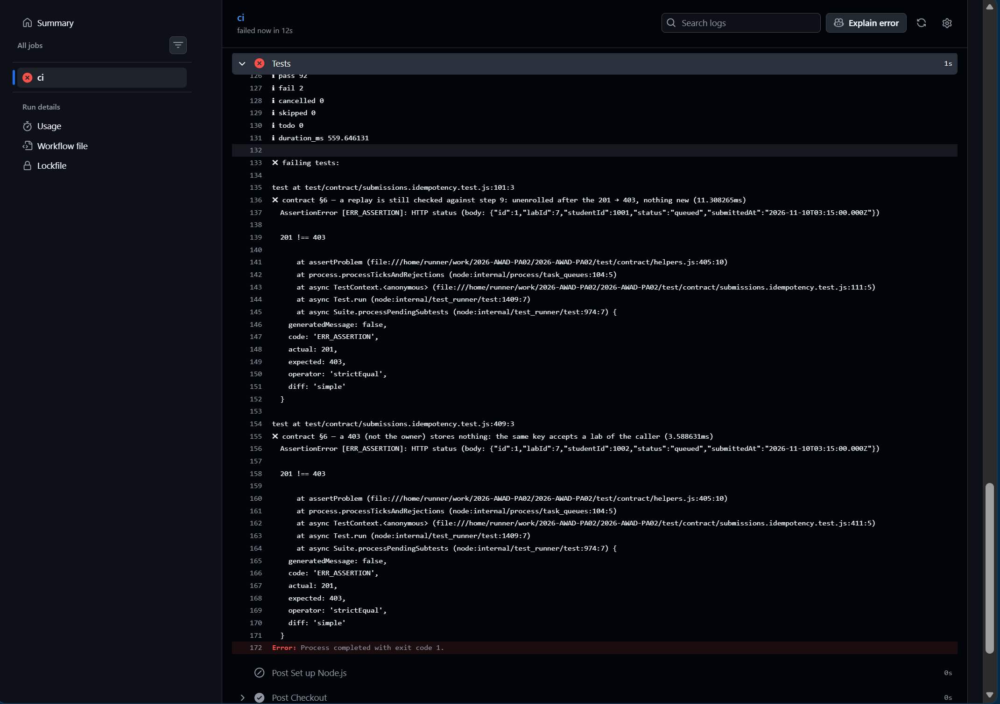
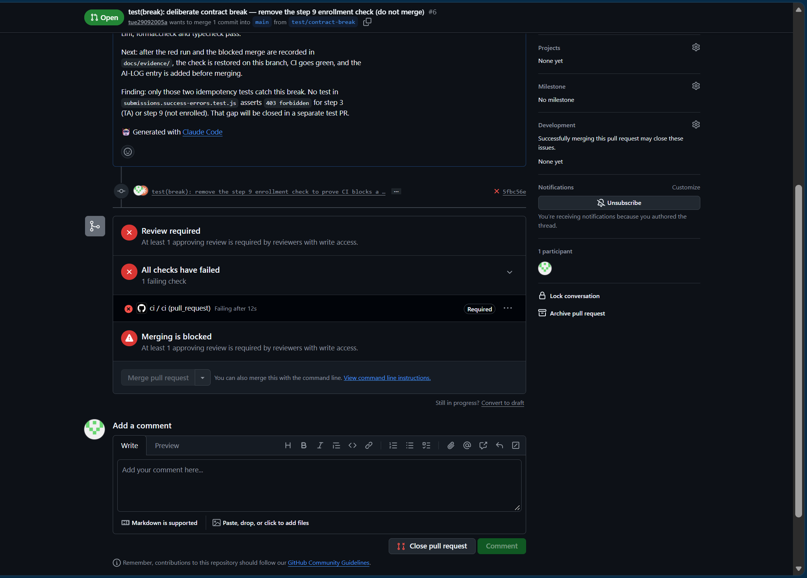

# Evidence: a deliberate contract break turns CI red and blocks the merge

Date: 2026-11-10 (+07:00)
Repo: https://github.com/tinphan247/2026-AWAD-PA02
Pull request: [#6 — deliberate contract break](https://github.com/tinphan247/2026-AWAD-PA02/pull/6)
Branch: `test/contract-break`, taken from `main` at `09280f7`
Contract rule broken: §5.4 step 9 of
[`docs/contract/post-labs-labId-submissions.md`](../contract/post-labs-labId-submissions.md),
"the student is not enrolled in the class that owns the lab: `403 forbidden`".

## Timeline

| Step | Commit | What changed | `ci` result |
| ---- | ------ | ------------ | ----------- |
| 1. Break | [`5fbc56e`](https://github.com/tinphan247/2026-AWAD-PA02/commit/5fbc56e7ee3ac7aaad63a2ac3eee2cf8723b51e0) | Removed the enrollment check from `src/domain/submissions.js`. No test or contract change. | **Red**: [run 42780786873](https://github.com/tinphan247/2026-AWAD-PA02/actions/runs/42780786873/job/129710055163), 92 pass, 2 fail. Merge blocked. |
| 2. Fix | [`75bd4aa`](https://github.com/tinphan247/2026-AWAD-PA02/commit/75bd4aa006d0dfb89f41e622c2bf4eec5214f3d4) | Reverted step 1, so `src/` is identical to `main` again. Added this evidence. | **Green**: [run 42781613985](https://github.com/tinphan247/2026-AWAD-PA02/actions/runs/42781613985/job/129712745826), 94 pass. |
| 3. Update | [`3dda6e6`](https://github.com/tinphan247/2026-AWAD-PA02/commit/3dda6e67cdc6ff8d0de8e42fcf756308fa82a0b7) | Merged `main` (PR #7) to resolve an `AI-LOG.md` conflict. | **Green**: [run 42783043055](https://github.com/tinphan247/2026-AWAD-PA02/actions/runs/42783043055), 97 pass. |

## Tests that caught the break

Both failed with `201 !== 403`: the server created a submission for a student
who is not enrolled in the lab's class.

- `test/contract/submissions.idempotency.test.js:101` —
  `contract §6 — a replay is still checked against step 9: unenrolled after the 201 → 403, nothing new`
- `test/contract/submissions.idempotency.test.js:409` —
  `contract §6 — a 403 (not the owner) stores nothing: the same key accepts a lab of the caller`

## Screenshot 1: the red CI log (step 1)

[`ci-github_agent_error-6.png`](ci-github_agent_error-6.png) shows the Tests
step of run 42780786873: `pass 92`, `fail 2`, and both failing tests with
`actual: 201, expected: 403`.

## Screenshot 2: the blocked merge (step 1)

[`ci-pullrequest-6.png`](ci-pullrequest-6.png) shows PR #6 at commit `5fbc56e`:
"All checks have failed", `ci / ci (pull_request)` marked **Required**,
"Merging is blocked", and the merge button disabled. The same screen also shows
"Review required", which is a second, independent blocker; the **Required**
badge on `ci` is what shows that the red check alone would block the merge.

## Interpretation

- The contract tests run in the required `ci` check and fail when the server
  breaks the contract.
- A red required check blocks the merge.
- The fix turned the check green without touching any test or the contract.
- Merging PR #6 does not change `src/`: the break and its revert cancel out,
  and only this evidence and the AI-LOG entry reach `main`. The break stays
  visible in commit `5fbc56e` and in the PR's check history.
